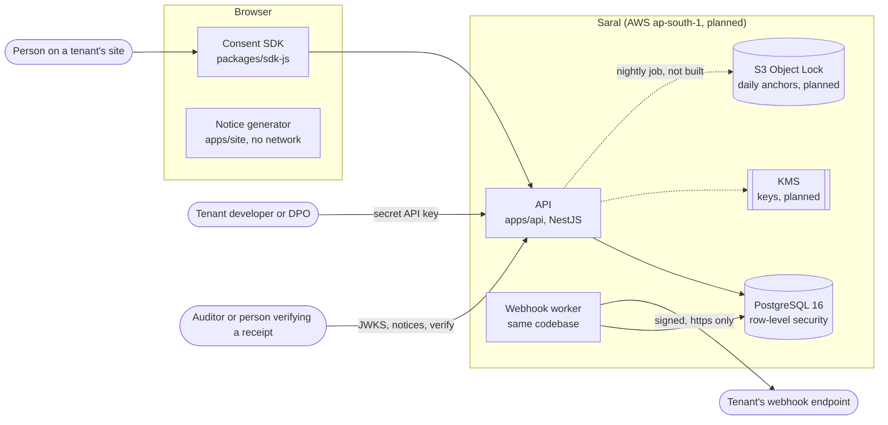

# High-level design

Status: describes the system as built on 2026-11-06 and, where marked **designed, not built**, the parts that are specified but not yet implemented. `docs/PLAN.md` is the plan and the schedule; this file is the architecture. The contract of the HTTP API is `docs/design/openapi.yaml`. The module-level detail is in `docs/design/LLD.md`. Threat models are in `docs/threat-model/`.

## 1. What the system does

A data fiduciary (the tenant) wants to collect consent from people under the Digital Personal Data Protection Act. Saral gives the tenant:

1. A free **notice generator** (English and Hindi drafts) that runs in the browser.
2. A **browser SDK** that shows a granular, default-off consent dialog and lets people withdraw as easily as they agreed.
3. An **API** that records each consent, issues a **signed receipt** (Kantara KI-CR-v1.1.0 as an RS256 JWT, verifiable with a public JWKS), and appends to a **tamper-evident audit log** (HMAC hash chain with a daily Merkle anchor).
4. **Webhooks** that tell the tenant's systems about consents and withdrawals.
5. **Data-principal rights handling** (requests, a DPO queue, erasure), a staff dashboard, and staff login with MFA.

The product does not claim legal compliance. It provides tooling; counsel for the tenant stays responsible (`CONTRIBUTING.md`).

## 2. System context



## 3. Components

| Component | Where | Built | Responsibility |
|---|---|---|---|
| Canonical strings v1 | `packages/schemas` | yes | The frozen byte format of audit entries and consent records (ADR 0002). |
| Audit chain | `packages/audit-chain` | yes | HMAC chain, RFC 6962 Merkle tree, daily anchor, verification. Pure functions. |
| Receipts | `packages/receipts` | yes | Kantara receipt claims, RS256 signing and verification, JWKS. |
| Notice engine | `packages/notice` | yes | Validated input, English and Hindi templates, canonical text and SHA-256. |
| Consent SDK | `packages/sdk-js` | yes | Dialog, requests, local decision state. 6 kB gzipped. |
| Notice generator | `apps/site` | yes | Free tool at `/notice-generator`. No network requests, nothing stored. |
| API | `apps/api` | yes | Auth by API key and scope, consent, receipts, audit verification, webhooks, public JWKS and notices. |
| Database | `apps/api/db/migrations` | yes | Tenancy boundary, immutability rules, outbox. |
| Webhook worker | `apps/api/src/webhooks` | yes | Delivery with retries; runs in the API process when `SARAL_WEBHOOK_WORKER=on`. |
| Infrastructure | `infra/terraform` | partly | Audit anchor bucket (Object Lock) and environment stacks. KMS, RDS, ECS not built. |
| Nightly anchor job | not built | no | Reads a day's chain, builds the anchor, writes it to S3 with Object Lock. |
| KMS key provider | not built | no | The development provider derives keys from one secret and refuses production. |
| Rights requests (DSR) | `apps/api/src/dsr` | yes | State machine, SLA due dates, DPO queue, sealed contacts, erasure. See LLD section 9. |
| Staff login with MFA | `apps/api/src/staff` | yes | Password, authenticator code, recovery codes, session tokens. See LLD section 10 and ADR 0004. |
| Staff dashboard | `apps/web` | yes | Sign-in with MFA, overview, rights-request queue, audit page, notice publishing, integrations, account and password change. See LLD section 11 and threat model 0009. Consent search and a funnel are not built. |
| ML service | `apps/ml` | shell | Health endpoint only. Translation is done offline (decision D10). |

## 4. Key flows

### 4.1 Granting consent

```mermaid
sequenceDiagram
  participant P as Person
  participant S as SDK
  participant A as API
  participant D as PostgreSQL
  P->>S: switches purposes on, Accept
  S->>A: POST /v1/consents (publishable key, no cookies)
  A->>D: BEGIN; SET LOCAL ROLE saral_app; set tenant from the key
  A->>D: read notice and purpose definitions (retention from the notice)
  A->>D: find or create principal (keyed HMAC of identifier and tenant)
  A->>D: insert consent_records
  A->>D: lock tenant chain, read head, seal entry, insert audit entry
  A->>D: sign receipt (RS256), insert consent_receipts
  A->>D: insert webhook_deliveries (outbox)
  A->>D: COMMIT
  A-->>S: 201 { consentId, receiptId, receipt } (200 for a retry with the same Idempotency-Key)
  S-->>P: dialog closes, "Privacy choices" button stays
```

Everything in the box is one transaction: a consent exists if and only if its audit entry, its receipt and its queued webhooks exist. The identifier (phone or email) is used to compute the pseudonym and is then discarded.

### 4.2 Withdrawing

`POST /v1/consents/{id}/withdraw` with the identifier withdraws one consent: both the id and the identifier must match. A tenant's server (a secret key) can call `POST /v1/consents/withdraw` with the identifier alone to withdraw every granted consent of a person after it has verified the person; a publishable key gets 403, because knowing someone's email address must not be enough. The pseudonym is recomputed and compared in constant time; a wrong identifier looks like an unknown consent (404). The consent moves from `granted` to `withdrawn` (a database trigger allows only that direction), a second audit entry is appended whose payload hash covers the new state, and a `consent.withdrawn` event is queued.

### 4.3 Verifying the audit log

`GET /v1/audit/verify` (auditor scope) recomputes the tenant's chain, or one UTC day of it, and reports the first entry that does not match. `GET /v1/audit/merkle-root?date=` returns the day's anchor (count, head hash, Merkle root) and refuses to when the day's chain does not verify. The chain alone cannot see rows removed from the end or a rewrite by someone holding the HMAC key; the daily anchor in S3 Object Lock (designed, not built) is what closes that gap.

### 4.4 Delivering webhooks

The worker claims due rows (`SKIP LOCKED`, at most 20 per tenant per claim), sends them outside any transaction with a signature `t=<unix>,v1=<HMAC>`, and records the outcome. Different endpoints are served at the same time; one endpoint's deliveries go in order; an endpoint that uses up its 60 second budget has the rest of its batch released without counting an attempt. Retries back off from 10 seconds to 6 hours with jitter, 15 attempts, then `failed`. Delivery is at least once; the receiver de-duplicates on `Idempotency-Key`.

## 5. Trust boundaries and the main controls

| Boundary | Control |
|---|---|
| Internet to API | API key (HMAC-stored, constant-time) or staff session (password and authenticator code), scopes, deny by default for every route, uniform 401, per-key origin lists, CORS that never allows cookies. No rate limiting yet. |
| Tenant to tenant | Row-level security with `FORCE` on every tenant-owned table, composite `(tenant_id, id)` foreign keys, a non-superuser application role, cross-tenant ids answer 404. Tests run as that role. |
| API to database | One transaction per request, tenant set per transaction, least-privilege grants, append-only audit table, consent state machine in a trigger. |
| API to tenant endpoints | https only, public addresses only (checked at registration and at connect time), no redirects, signed payloads with ids and states only. |
| Keys | Development provider only. Production boots with a provider that answers 503; KMS adapters are not built. |

## 6. Deployment (planned; only the audit bucket module exists)

AWS ap-south-1 (Mumbai) primary. ECS Fargate for the API and a worker service from the same image; RDS for PostgreSQL 16 (single-AZ in dev); KMS for the audit HMAC key, pseudonym key, webhook key and the receipt signing key; S3 with Object Lock for daily anchors (Governance mode outside production, Compliance mode in production, 7 to 10 years); Cloudflare or CloudFront with WAF in front; OpenTelemetry to Grafana. Terraform, no Kubernetes. The marketing site and notice tool hold no personal data and may be hosted elsewhere (decision D5). Cost has not been estimated: the pricing API call failed during planning.

## 7. Failure modes

| Failure | Behaviour |
|---|---|
| Database down or a connection dropped | Authenticated routes answer 5xx; `/healthz` stays up (it never touches dependencies); the pool logs dropped idle connections and reconnects (it does not crash the process); nothing is partially written because each request is one transaction. |
| Key provider missing (production today) | Anything needing a key (API keys, receipts, the JWKS) answers 503. `/healthz` keeps working; the public notice route needs only the database. |
| Receipt signing fails or the tenant profile is incomplete | The whole grant rolls back (422 for an incomplete profile); no consent without a receipt. |
| Webhook endpoint down or slow | Retries with backoff; other endpoints and tenants are unaffected; a delivery that exhausts 15 attempts is marked `failed`. |
| Worker crashes mid-delivery | The claim expires after 5 minutes and the row is sent again (at least once). A row left at 15 attempts is closed as failed by a sweep, so it cannot block the claim for other tenants. |
| Two requests append to one tenant's chain | A per-tenant advisory lock serialises them; a database trigger refuses a fork or a gap. |
| Someone edits the audit table | Update, delete and truncate are refused for everyone, including the owner. An owner who disables the triggers is caught by `verify` and by the anchor. |
| Clock goes backwards | Audit timestamps never decrease. |

## 8. Known gaps (also listed in the threat models)

- Nothing proves a person controls the identifier they type, so a consent can be forged through a publishable key.
- Rate limits are counted in each instance's memory, so with several instances a caller can get that many times the limit; no circuit breaker for failing webhook endpoints.
- No nightly anchor job, no KMS provider, no deployment.
- Hindi text is an unreviewed draft; the four further languages are not started.
- Staff accounts are made and recovered by an operator tool that works only with the development key provider, an operator knows a new account's initial password until the person changes it (the session of such an account can do nothing else until then), and the dashboard has no content security policy for scripts (threat models 0008 and 0009).
