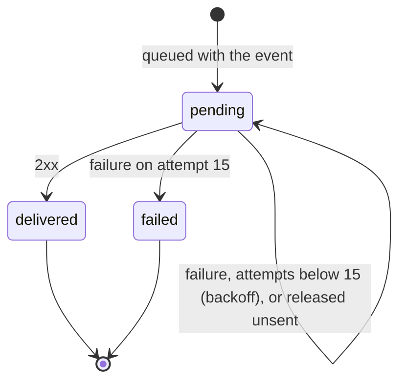
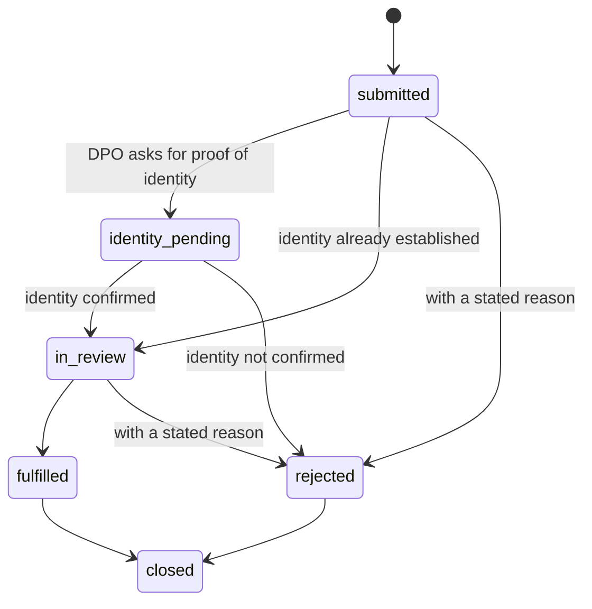

# Low-level design

Status: describes the code as built on 2026-11-06. Sections 9 to 11 describe parts that are built, and each names what is still missing. The HTTP contract is `docs/design/openapi.yaml` (a test fails when the routes or their access rules drift from it). Architecture and flows are in `docs/design/HLD.md`.

## 1. Repository map

| Path | What it is |
|---|---|
| `packages/schemas` | `canonicalAuditEntry`, `canonicalConsentRecord`, version constants. No dependencies, no crypto. |
| `packages/audit-chain` | `entryHash`, `sealEntry`, `verifyChain`, `merkleRoot`, `merkleProof`, `verifyMerkleProof`, `buildAnchor`, `anchorBody`, `verifyAgainstAnchor`, `verifyLinksAgainstAnchor`, and the `saral-audit-verify` command. Node `crypto` only. |
| `packages/receipts` | `buildReceiptClaims`, `validateClaims`, `signReceipt`, `verifyReceipt`, `buildJwks`, `createLocalSigner`. Node `crypto` only (`jose` is a test-only oracle). |
| `packages/notice` | `validateNoticeInput`, `renderNotice`, `canonicalNoticeText`, `noticeSha256`. |
| `packages/sdk-js` | `init`, the dialog and its state. tsup builds IIFE, ESM and CJS. |
| `apps/api` | NestJS 12 (ESM). `src/` code, `db/migrations/` SQL, `test/` end-to-end and database tests. |
| `apps/site` | Next.js 16: home page, the notice generator (client-side only) and the receipt verifier at `/verify`. |
| `apps/web`, `apps/wallet`, `apps/ml` | Shells with a heading or a health route. |
| `infra/terraform` | Audit anchor bucket module and the dev, staging and prod stacks. |

## 2. Canonical strings v1 (frozen, ADR 0002)

A canonical string is `JSON.stringify` of a fixed-order array of validated values, so no field can be mistaken for another.

- Audit entry: `["saral.audit", 1, tenantId, seqNo, ts, actorType, actorId, action, refTable, refId, payloadSha256]`
- Consent record: `["saral.consent", 1, tenantId, consentId, principalId, noticeId, noticeSha256, purposes, status, grantedAt, withdrawnAt, collectionMethod]`, with `purposes` as `[key, granted, retentionDays]` triples sorted by key in code-unit order.
- Rules: lowercase UUIDs; `seqNo` a decimal string up to bigint range; timestamps `YYYY-MM-DDTHH:mm:ss.sssZ` that round-trip; hashes 64 lowercase hex; `action` matches `^[a-z]+(\.[a-z_]+)+$`; `actorId` null or 1 to 128 characters; purposes unique, 1 or more, retention 0 to 36500 days; `withdrawnAt` set exactly when the status is `withdrawn`. Anything else throws `CanonicalError` naming the field.
- Other record kinds that need an audit `payloadSha256` define their own small canonical array next to their service (for example `["saral.webhook_endpoint", 1, tenantId, id, url, sortedEvents, secretVersion]`).

## 3. Audit chain

- `entryHash = HMAC-SHA256(key, prevHash || canonical)`, lowercase hex, key at least 32 bytes. `prevHash` of a tenant's first entry is 64 zeros.
- A verify request is limited to 100,000 entries (`AuditService.maxEntries`) and answers 422 `too_large` beyond it; verify by UTC day instead.
- `verifyChain(entries, resolveKey, { startPrevHash, startSeqNo, startHmacSchemaVersion })` checks each entry in order: same tenant, supported canonical version, contiguous `seqNo` (BigInt), previous hash, key known, key version not lower than before, fields valid, hash equal (constant time). The first failure is returned as `{ ok: false, failure, seqNo }` with `failure` one of `tenant_mismatch`, `unsupported_version`, `seq_gap`, `prev_mismatch`, `unknown_key`, `key_version_regression`, `invalid_fields`, `hash_mismatch`.
- Merkle tree: RFC 6962. Leaf hash `SHA-256(0x00 || 32 bytes of the entry hash)`, node `SHA-256(0x01 || left || right)`, split at the largest power of two below n, empty tree `SHA-256("")`. Inclusion proofs follow RFC 9162. A proof binds a leaf to a root; the size only shapes the path, so the anchor's `count` pins the size.
- Anchor: `{ version: 1, tenantId, date, count, firstSeqNo, lastSeqNo, headHash, merkleRoot }`. `anchorBody` is compact JSON in that key order plus a newline: the exact bytes for S3. `verifyAgainstAnchor` verifies the chain and then every anchor field, which catches truncation and key-holder rewrites.

- Keyless check: `verifyLinksAgainstAnchor(entries, anchor, { startPrevHash })` is what an outside auditor, who does not hold the HMAC key, can prove: the entries belong to the anchor's organisation, their numbers are contiguous, each points at the hash of the one before (the first day at the genesis hash, a later day at the previous day's head, given as `startPrevHash`), and the count, first and last numbers, head hash and Merkle root all equal the anchor's. A removed, added, reordered or replaced entry fails. It cannot see a changed field that leaves the stored hashes alone, because recomputing a hash needs the key; `verifyAgainstAnchor` does that.
- `saral-audit-verify --anchor <file> --entries <file> [--previous-anchor <file>] [--key <version>=<keyfile> ...]` (`packages/audit-chain/src/verify-cli.ts`, `pnpm --filter @saral/audit-chain verify-audit`) runs those checks on files only, with no database, API or network. It reads regular files of bounded size (the anchor 4 KB, a key 1 KB, the entries 256 MB), refuses a previous anchor that is for another organisation or does not end at the entry before this one's first, and says in words what it checked and what it did not. Exit code 0 match, 1 mismatch, 2 unusable input. `GET /v1/audit/entries?date=` (auditor scope) gives a day's entries for it: hashes, ids, times, actor and action, no personal data.
- Nightly job: `AnchorJob.run({ date, store, now })` (`pnpm --filter @saral/api anchor [--date]`, default yesterday UTC, writes to the folder in `ANCHOR_DIR`). It lists the organisations as the `saral_anchor` role (migration 0011: it reads only `tenants.id`), then for each reads its day through `AuditService.anchor`, which verifies the chain first, and writes `anchors/<tenantId>/<date>.json` (exactly `anchorBody`) with `ObjectStore.putIfAbsent`. An anchor already stored is never replaced: identical means a repeat (`unchanged`), different is reported as `anchor_conflict`, which is the tampering signal the anchors exist for. A broken chain (`chain_invalid`, with the failing entry), a read problem or a store problem is reported for that organisation only and the others are still anchored. Before it reads a day the job takes the organisation's append lock, which an append holds until it commits, so an entry stamped inside the day but committed after midnight is waited for and not missed (`AuditService.anchor(..., { lock: true })`). A day with no entries but a stored anchor is an `anchor_conflict`, not a skip. Each day is also checked against the latest anchor stored for an earlier day (found with `ObjectStore.list`, since days with no entries have none): the day's first entry must be the next number and point at that anchor's head, or the result is `broken_link` and nothing is written, which catches an anchored tail that was removed and then covered by later entries. A previous anchor that cannot be read is a `store_error` for that organisation. `AuditService.now` is the clock for entry times, which tests set so that a run across midnight cannot move fixtures to another day. A day that is not over (before midnight UTC at its end) is refused. `FileObjectStore` makes each file read-only, publishes it whole by linking a temporary file into place, validates keys (lowercase letters, digits, `_ . -`, single slashes, no folder starting with a dot) refuses a folder that a link points out of the store before it makes any folder, refuses an object whose own name is a link (`O_NOFOLLOW`), and removes the temporary file of a write that fails. The command uses the development key provider and refuses production; the S3 Object Lock store, KMS keys and the schedule are not built.

## 4. Receipts

- Claims are the KI-CR-v1.1.0 receipt in the field names of the specification's JSON schema (`policyUrl`, `piiControllerUrl`, array `purposeCategory`; the prose of the specification disagrees, see `docs/RESEARCH.md` section 6) plus `iat`. `piiPrincipalId` must be a pseudonymous UUID. `consentReceiptID` must be a UUID v4. `policyUrl` must be https without credentials. `thirdPartyName` is required when disclosure is true; `spiCat` must be non-empty when `sensitive` is true.
- Extension claims `saralConsentId`, `saralNoticeId` and `saralNoticeSha256` (validated when present) say which consent and which exact notice text a receipt covers. `signReceipt` refuses a token the verifier would refuse (over 16 KiB).
- `signReceipt` validates, then signs `base64url(header).base64url(payload)` with RS256. Header: `{ alg: "RS256", typ: "JWT", kid }`, where `kid` is the RFC 7638 thumbprint.
- `verifyReceipt` order: token at most 16 KiB and three segments; canonical base64url; `alg` is exactly `RS256` (so `none`, HS256 confusion and others fail as `bad_alg`); the `kid` is in the key set; the key is RSA, `use` is `sig`, `alg` is `RS256` if set, modulus at least 2048 bits, exponent at least 65537; the signature verifies; the claims validate. Error codes: `malformed`, `bad_alg`, `unknown_kid`, `bad_key`, `weak_key`, `bad_signature`, `bad_claims`.
- `buildJwks` copies only `kty`, `n`, `e`, `kid`, `alg`, `use` and throws on private members, duplicate ids or non-RSA keys.

## 5. Notice engine

- Input is validated into one error list with field paths. Strings are trimmed, single line (no control or bidi characters; Indic zero-width joiners allowed), length-capped; URLs are https without credentials; at most 30 purposes with at most 50 data items each.
- `renderNotice(input, "en" | "hi")` fills fixed templates. Values are inserted once as plain strings. Sections: who we are, what data and why, who we share it with, rights, withdrawal, children, complaint, about this draft. Every notice has `reviewStatus: "pending-human-review"` and a banner.
- `canonicalNoticeText`: Unicode NFC, LF line endings, no trailing spaces, one final newline. `noticeSha256` is the SHA-256 of that text through Web Crypto. The database stores the canonical text and checks that its hash matches.

## 6. API

### 6.1 Settings

| Variable | Use |
|---|---|
| `PORT` | HTTP port, default 4000. |
| `DATABASE_URL` | PostgreSQL connection. Missing: database routes answer 503. |
| `NODE_ENV` | `production` makes the key provider answer 503 instead of using development keys. |
| `SARAL_DEV_MASTER_SECRET` | At least 32 characters. Development and test only; derives every key. Without it a random one is made per process. |
| `SARAL_WEBHOOK_WORKER` | `on` starts the delivery poller in this process. |
| `PUBLIC_BASE_URL` | Public https base URL of the API, used in receipts. |
| `TRUST_PROXY` | How many proxies sit in front of the app (1 to 10), so the caller's address is read from `X-Forwarded-For`. Unset or `0`: the connection's own address, and the header is ignored. Anything else makes the app refuse to start. Behind a load balancer it must be set, or every caller shares the balancer's address and is limited together. |

### 6.2 Request path

1. CORS (`configureApp`): reflects the origin, allows `Authorization`, `Content-Type` and `Idempotency-Key`, exposes `Retry-After`, never credentials.
1a. `IpRateLimitGuard` (global, first; `src/ratelimit`): counts the caller by address (IPv4, or IPv6 /64) in a fixed one-minute window, 600 requests, and the three sign-in routes (`@Throttle("auth")`) also in a bucket of 10. It runs before anything is looked up, so a flood of made-up keys or passwords never reaches the database or the password hash. Past a limit: 429, `Retry-After`, `{ error: "rate_limited" }`. `/healthz` is exempt (`@SkipThrottle`). The counters are in this process, in three separate tables (general, sign-in, key; `FixedWindowLimiter`, at most 100000 keys each, expired keys swept at most once a second and then the oldest dropped), so a flood against one cannot make another forget, and with several instances each counts separately.
2. `AuthGuard` (global): no `@Public()` or `@Scopes()` on the route gives 403. Otherwise parse `Authorization: Bearer <key>`, read the key row under the `key_lookup` policy, compare the HMAC of the secret in constant time, reject revoked keys and a kind mismatch (all with the same 401 body), check the origin list of a publishable key, check scopes (403). The result is `req.auth = { keyId, tenantId, kind, scopes }`.
2a. `PrincipalRateLimitGuard` (global, after `AuthGuard`): 1200 requests a minute per secret key or staff session, from anywhere. A request that failed to authenticate never reaches it. A publishable key is skipped: it is public, so a limit on the key as a whole would let anyone lock the tenant's own visitors out, and each address is limited on its own anyway.
3. Controller validates the body with small helpers (`objectBody`, `uuidParam`, `normalizeIdentifier`, ...) and answers 400 with `{ error: "invalid_request", field, message }`.
4. `Database.inScope({ tenantId })` (pool of 10, 5 second wait for a connection, 30 second statement limit, errors on idle connections are logged): `BEGIN`, `SET LOCAL ROLE saral_app`, `set_config('app.tenant_id', ..., true)`, the work, `COMMIT` or `ROLLBACK`. `Database.asWorker` does the same as `saral_worker` for the webhook worker.

### 6.3 API keys

`pk_<32 hex>_<43 base64url>` or `sk_...`. The 32 hex are the key's UUID without dashes. Only `HMAC-SHA256(pepper, secret)` is stored. A publishable key has exactly the scope `sdk` (a CHECK). Keys are issued by operators through `issueApiKey` (the API role cannot write keys); there is no route for it yet.

### 6.4 Consent grant (`ConsentService.grant`, one transaction)

Read tenant profile and notice; map the request's purposes (sorted by key) to the notice's definitions (unknown purpose is 422; retention comes from the definition); at least one purpose must be granted (422); principal id from the pseudonym `HMAC(pseudonymKey, JSON(["saral.principal", identifier, tenantId]))`; take the tenant lock, and if the request carries an `Idempotency-Key` that was already used for the same request (same person, notice and choices, consent still granted) return the first result (200; a different request or a no-longer-granted consent is 409); otherwise insert the consent (with the key); append the audit entry with `payloadSha256 = SHA-256(canonicalConsentRecord)`; build and sign the receipt (an incomplete profile is 422 and rolls everything back); insert the receipt; enqueue webhooks. The receipt's `policyUrl` is `<PUBLIC_BASE_URL>/v1/notices/<id>` when that https base is configured (the notice never changes), otherwise the tenant's own page. Withdrawal is the same shape with a state change and a `consent.withdrawn` entry; `POST /v1/consents/withdraw` (secret keys only) does it for every granted consent of a person found by identifier. Migration 0005 adds `consent_records.idempotency_key`, unique per tenant.

### 6.5 Audit append (`AuditService.append`)

`audit_append_lock(tenant)`, read the head, `ts = max(now, head.ts)`, `seqNo = head + 1`, seal with the current key version, insert. The database also checks the link and the shape.

### 6.5a Notice publishing (`NoticeService`, `buildNotice`)

`POST /v1/notices` (`tenant_admin`) takes a language (`en` or `hi`), the notice values, and a list of purposes. Each purpose has the wording the notice shows (`name`, `description`, `dataItems`, `retention`) and what its receipts say (`key`, `retentionDays`, `purposeCategory`, `piiCategory`, `thirdPartyDisclosure`, `thirdPartyName`, `primaryPurpose`). `buildNotice` validates everything, refuses fields that are not part of the request, and reports problems by their place in the request without repeating what was submitted. The text is made by `renderNotice` from the reviewed template, never taken from the caller, and is stored as `canonicalNoticeText` with its SHA-256 (the database checks the hash). A purpose that discloses to a third party must name an organisation listed in `notice.thirdParties`, so a receipt never mentions a recipient the notice does not. Every receipt's `termination` is the notice's withdrawal URL. A receipt is limited to 16 KiB (`MAX_TOKEN_CHARS`), so when the organisation has a receipt profile the service measures the largest receipt the notice could produce (every purpose granted, the longest collection-method text, the real policy URL, plus 1000 characters for the header and a 4096-bit signature) and refuses the notice with 422 `receipt_too_large` if it would not fit; without this, every consent granting all purposes would fail with `incomplete_setup`. In one transaction, under the same per-organisation lock as the audit chain, the service takes the next version of that language, inserts the row with `clock_timestamp()` (so the list order follows the version order), and appends `notice.published`. The row is marked `pending-human-review` and no API changes that. `GET /v1/notices` lists the organisation's notices newest first, without text. A notice never changes; an edit is a new version, and every publication is a new version (a retried request after a lost response makes another).

### 6.5b Consent review (`ConsentReviewService`, officer only)

`POST /v1/consents/search` (scope `dpo`) takes `{ identifier }` (E.164 phone or email, normalised as for a grant), turns it into the person's pseudonym and looks for the principal with `SELECT`; a person who has no consent is not created, and nothing is audited for them. For a person found it answers their consents newest first, at most 100 with `truncated` (one more row is read to know), each with its state, times, collection method, notice id, version and language, the purposes (key and whether agreed to; not the retention) and the first receipt id. The identifier and the pseudonym are never in the answer, and a search that finds a person appends the audit entry `consent.searched` (actor `staff:<id>` as the officer when it is a session, `api-key:<id>` as the system when it is a key, referring to the person's internal id, with a payload hash over the tenant and that id). It is a POST so that the identifier is in the body, not in an address that servers and browsers keep. `GET /v1/consents/summary?days=` (1 to 366, default 30) answers counts only: totals by state over every consent, per purpose the consents that agreed to it by state, and one line for every UTC day of the period (oldest first, zeros included) with the consents given and withdrawn that day. Both are for the officer's role only: an administrator and an auditor get 403, because finding a person's consents is access to personal data.

### 6.6 Webhooks

Registration (`tenant_admin`): URL rules and SSRF checks (`url-guard.ts`), at most 10 active endpoints per tenant counted under the tenant lock, an audit entry, and the secret `whsec_<base64url>` shown once. `DELETE /v1/webhook-endpoints/{id}` disables an endpoint (frees its slot; the worker closes events still waiting for it) and `POST .../rotate-secret` bumps `secret_version` and shows the new secret once; both are audit events. The secret is `HMAC(webhookKey, "<endpointId>:<secretVersion>")`; nothing is stored. Delivery: see HLD 4.4; every run first sweeps rows that can never be sent (15 attempts left by a crashed worker, disabled endpoints). Header `X-Saral-Signature: t=<unix>,v1=<HMAC-SHA256 of "<t>.<body>">`. Body `{ id, type, createdAt, data }` with ids and states only. `GET /v1/webhook-endpoints/{id}/deliveries` (`tenant_admin`, optional `state` and `limit` of 1 to 100, default 50) is the delivery log, newest first, without payloads, and works for a disabled endpoint. `POST .../deliveries/{deliveryId}/redeliver` puts a failed delivery of an enabled endpoint back to pending with no attempts used, due now (409 `not_failed` or `endpoint_disabled` otherwise; an audit event `webhook.delivery_redelivered`); the worker then sends it with the same `Idempotency-Key`. Migration 0010 lets the application role update three delivery columns, and a trigger lets it do exactly that one move and nothing else; the worker role is not held to it. When a delivery fails for good the worker asks `WebhookService.disableIfFailing`: if the endpoint's ten most recent finished deliveries have all failed (none delivered among them) it is disabled with `disabled_reason = 'failures'` and an audit event `webhook.endpoint_auto_disabled` by `system:webhook-worker`; the list shows `disabledReason` (`admin` for an administrator and for endpoints disabled before reasons were kept).

### 6.7 Breach incidents (`BreachService`)

`POST /v1/breaches` (officer or administrator) records a personal data breach from the incident form: title, what happened, when the organisation found out (`discoveredAt`), when it happened (optional), the nature (confidentiality, integrity, availability), the kinds of personal data, about how many people (optional), the likely consequences and what has been done. Times are full ISO times with their zone, not in the future (five minutes of clock difference allowed) and not more than ten years old; a field that is not part of the form is a 400. `GET /v1/breaches` lists the newest 100 by discovery, `GET /v1/breaches/{id}` one, and `PATCH /v1/breaches/{id}` corrects any of the fields (`null` clears the optional ones) only while the incident is `reported`, otherwise 409 `locked`.

An incident moves one way: `reported`, `signed_off`, `board_notified`, `closed`. `GET .../drafts` writes two plain-text drafts from the facts and the organisation's profile (`templates.ts`): the report to the Board and the message to the people affected, each starting with a line saying it is a draft nobody has reviewed. Saral sends neither. `GET .../drafts` also answers the SHA-256 of each draft. `POST .../sign-off` (officer only) carries those two hashes, the ones of the drafts the officer read, and the service compares them with the drafts as they are now inside the locked transaction: if the report was corrected in between it answers 409 `drafts_changed` and signs nothing, so the officer's word is never given to text they did not read. Otherwise it records who and when and the SHA-256 of exactly the two drafts, and from then the record cannot change. `POST .../board-notified` (officer only, after sign-off) records the time the officer says the Board was told, which cannot be before the breach was found or in the future, and the reference the Board gave. `POST .../principals-notified` (officer only, once, after sign-off, before or after the Board) records how the people were told and how many (zero is allowed). `POST .../close` (officer only) needs the Board told (409 `illegal_transition` otherwise) and the people told (409 `principals_not_notified`), and a closing note.

The Board's period is `BOARD_DEADLINE_HOURS` = 72 from `discoveredAt`, the figure the plan cites for Rule 7. The text of the Rule has not been read here, and the lawyer advisor must confirm the period, what it runs from and what has to be sent. Each answer carries `boardDeadline`, `boardOverdue` (the Board has not been told and the deadline has passed) and `boardNotifiedLate` (told after it; null until told). Every step is one transaction with its audit entry (`breach.reported`, `breach.updated`, `breach.signed_off`, `breach.board_notified`, `breach.principals_notified`, `breach.closed`), taken under the organisation's append lock and a row lock, so two people acting on one incident cannot both succeed. An entry holds a hash of the content and the time of each step, never the words, which can mention people.

Migration 0012 enforces it in the database too (`breach_incidents_guard`, which applies to the owner as well): an incident starts as reported; the report can change only while reported; each step's facts are written once, by the move into that step, and never change; the people are told once, after sign-off and before closing; closing needs them told; who reported and when never change. The application role can read, insert and update the workflow's columns, never delete.

## 7. Database (migrations 0001 to 0012)

Three database roles exist besides the owner, and none can log in: `saral_app` (every request), `saral_worker` (webhook delivery) and `saral_anchor` (the nightly job, which reads only `tenants.id`). The process connects with one login and switches with `SET LOCAL ROLE`, so that login must be allowed to: the database owner or a superuser can, and any other login needs `GRANT saral_app, saral_worker, saral_anchor TO <login>` once, which the migrations cannot do because they do not know the login's name. Without the grant for `saral_anchor` the nightly job stops before it reads any organisation, writes no anchors, and exits with an error.

| Table | Notes |
|---|---|
| `tenants` | `profile` jsonb (controller details, policy URL, service name) set by operators; read-only for the API role. |
| `tenant_principals` | `(tenant_id, id)` key; `pseudonym_hmac` unique per tenant. No raw identifiers. |
| `privacy_notices` | One row per language per version; canonical text and its SHA-256 (CHECKed); `purpose_definitions` jsonb; insert-only for the API role; also readable by id through `app.public_notice_id`. |
| `consent_records` | Composite foreign keys to the principal and to `(tenant_id, notice_id, notice_sha256)`. A trigger allows only `granted` to `withdrawn` or `expired` and changes to `status` and `withdrawn_at` only. |
| `consent_receipts` | Insert-only. |
| `consent_audit_log` | Primary key `(tenant_id, seq_no)`; triggers check the chain link, refuse update, delete and truncate; millisecond timestamps. |
| `api_keys` | Visible only through `app.api_key_id`. |
| `webhook_endpoints`, `webhook_deliveries` | Outbox; the `saral_worker` role reads due rows of every tenant and updates outcome columns only. |

Every tenant-owned table has row-level security enabled and forced with a policy that also checks writes. Every function pins `search_path = pg_catalog, public, pg_temp`; `TEMPORARY` is revoked from `PUBLIC`. Migrations are SQL files applied by a small runner that records SHA-256 checksums and refuses edits to applied files. `pnpm --filter @saral/api db:migrate` applies them.

## 8. State machines

Consent (enforced by a trigger): `granted` to `withdrawn` or `expired`. A finished consent never changes; a new consent is a new row.

Webhook delivery:

SDK: `closed`, `banner`, `manage`. First visit opens `banner`. A decision (`granted` or `refused`) is stored; with `granted`, the opener shows `manage`, where withdrawal clears the state.

## 9. Data-principal rights (built)

States: `submitted`, `identity_pending`, `in_review`, `fulfilled`, `rejected`, `closed`. Types: `access`, `correction`, `erasure`, `nomination`, `grievance`. The state machine is in `apps/api/src/dsr/state.ts` and is enforced again by a database trigger; a test compares all 36 state pairs between the two.

- Tables (migration 0006): `dsr_requests` (row-level security; the API role may update only `state`, `decided_reason` and `closed_at`), `principal_contacts` (the person's contact sealed with AES-256-GCM, `src/crypto/contact-crypto.ts`: version byte, 12-byte nonce, ciphertext, tag; bound to tenant and person as associated data). Webhook events `dsr.submitted` and `dsr.transitioned` (ids and states only).
- `slaDueAt(submittedAt, type)` is 30 days for every type, a working default **not confirmed against the Rules**.
- Routes: `POST /v1/dsr` (`sdk`; same answer for known and unknown people), `GET /v1/dsr` with `state` and `overdue` filters, `GET /v1/dsr/{id}`, `POST /v1/dsr/{id}/transition` (409 with the allowed moves; a rejection needs a reason), `POST /v1/dsr/{id}/reveal-contact` (410 after erasure). All but the first need the `dpo` scope, which is a secret API key until staff login exists.
- Every submission, move and contact read is an audit entry (`dsr.submitted`, `dsr.transitioned`, `dsr.contact_revealed`) with a hash of the request's state and reason.
- Fulfilling an **erasure** request runs, in the same transaction as the move: withdraw all of the person's granted consents (each audited and queued), delete the sealed contact, replace `tenant_principals.pseudonym_hmac` with a random value so the identifier no longer leads to the person. The audit chain keeps its entries and still verifies. The lawyer advisor must confirm that this satisfies the Act (`docs/PLAN.md` section 5.2).
- Threat model: `docs/threat-model/0007-rights-requests.md`.

## 10. Staff login with MFA (built)

Decisions and parameters are in `docs/adr/0004-staff-authentication.md`; threats in `docs/threat-model/0008-staff-authentication.md`.

- Tables (migration 0007): `staff_users` (email sealed and indexed by HMAC, role `tenant_admin` or `dpo`, scrypt hash with pinned parameters, sealed authenticator secret, last accepted step, failure count, lock time, session version) and `staff_recovery_codes` (HMACs, `used_at`). The API role cannot create or delete staff; it can record sign-in progress only. A `slug_lookup` policy lets sign-in find a tenant by its slug.
- Flow: `POST /v1/auth/login` (tenant slug, email, password) returns a 5 minute **challenge** and `mfa: enroll | verify`. First time: `POST /v1/auth/mfa/enroll` returns a Base32 secret and an `otpauth://` link; `POST /v1/auth/mfa/verify` with a code confirms it, returns eight recovery codes once, and returns the **session**. Later: login, then verify. `POST /v1/auth/refresh` extends a session until eight hours after the last full sign-in. `GET /v1/auth/me` says who is signed in.
- Session token: `st_v1.<payload>.<HMAC-SHA256>` with a purpose, subject, tenant, role, session version, issue, expiry and sign-in time. 15 minutes. The guard re-reads the account on every request, so disabling a person or bumping `session_version` signs them out. Scopes by role: `tenant_admin` gets `tenant_admin` and `auditor`; `dpo` gets `dpo` and `auditor`.
- Audit: `staff.logged_in`, `staff.mfa_enrolled`, `staff.locked`; later actions carry `staff:<id>` as the actor. `AuthContext.actor` replaced the key id as the audit actor everywhere.
- Operators use `pnpm --filter @saral/api operator <command>` (`src/operator`): `tenant:create --name --slug`; `staff:create --tenant --email --role`; `staff:reset --tenant --email`; `staff:disable` and `staff:enable` with the same flags; `profile:set --tenant --file` (the organisation's controller profile, checked by building a sample receipt from it, so a profile that is saved is one the API can sign receipts with; it is read from a regular file of at most 20 KB, never a pipe, and may have at most 4000 characters because a receipt is limited to 16 KiB in all); `key:issue --tenant --kind --name [--scopes] [--origins]`, `key:list --tenant` and `key:revoke --tenant --id` (API keys: the token is printed once and only a keyed hash is stored; a publishable key is always `sdk` only and may be limited to origins, which are stored the way a browser sends them (lowercase host, default port and trailing slash dropped, IPv6 in brackets; https only, or `http://localhost`; never a path, query, credential or wildcard), a secret key defaults to `sdk` and may have others; listing never shows secrets; revoking is immediate and repeating it keeps the first time). The API role cannot write keys or the profile, so these two are operator-only by design. Passwords are generated (24 random characters) and printed once, never taken from the command line. A reset gives a new password, ends every session, clears a lock, and removes the authenticator and recovery codes, so the person sets up again. Disabling ends every session. The tool needs `DATABASE_URL` for a role that bypasses row-level security and the same `SARAL_DEV_MASTER_SECRET` as the API (it refuses to run without it, and in production). Unexpected errors print only their code, because their text can carry connection strings. A person changes their own password with `POST /v1/auth/password` (`StaffService.changePassword`, migration 0008 grants the application role `UPDATE (password_hash, session_version)` and nothing more of the account): the current password is checked after the new one is judged, wrong ones count toward the same lock as sign-in and answer 422 (never 401, which would end the session in the dashboard), a session already past eight hours since the real sign-in is refused (401), as refresh is, success raises `session_version` (every other session ends), clears the failure count, appends `staff.password_changed`, and answers a new session that keeps the real sign-in time. An account made or reset by the operator tool is marked `must_change_password` (migration 0009; the application role may write only that flag, so that changing a password can clear it). The marked person signs in as usual and the session answers `mustChangePassword: true` (also on `/v1/auth/me` and when renewed), but `AuthGuard` refuses every route except `/v1/auth/me`, `/v1/auth/refresh` and `/v1/auth/password` (those carry `@AllowPendingPasswordChange()`) with 403 `password_change_required`, after the scope check. Changing the password clears the flag and answers a session with `mustChangePassword: false`. The operator still knows the initial password until then, but can no longer use the account through the API for anything else, and the tool says so when it prints the password. API keys have no password and are not affected.

## 11. Dashboard (built, core screens)

`apps/web` is a Next.js app with one client boundary (`src/app/providers.tsx`): the session provider, the sign-in gate and the navigation around every page. It reuses the system-font approach of `apps/site` (light theme, no third-party requests). The palette is in `src/lib/tokens.ts` and `src/app/globals.css`; a test checks every text and control pair against WCAG AA (4.5 to 1 for text, 3 to 1 for field borders and focus rings) and that each colour appears in the stylesheet.

**Screens.**

- Sign-in: organisation, email and password, then the authenticator code. A first sign-in shows the setup key and then the recovery codes once; the session starts only after the person confirms they saved them. A wrong code can be retried without starting over, and the password is cleared as soon as it has been sent.
- Overview: for the officer, the number of open, overdue and soon-due requests and a plain-words alert when any are overdue; for the administrator, the number of active webhook endpoints. Both roles also get a breach alert (`BreachAlert`): the count of breaches the Board has not been told about that are past the 72-hour deadline, and of those due within 24 hours, each in words with a link to the Breaches page; nothing when there is nothing to say, and a quiet note if the breaches could not be read, which never hides the rest of the page.
- Requests (officer): the queue with a status filter and an overdue-only filter, each row with a text deadline badge ("Overdue by 2 days", "Due in 22 days", "Finished") so colour is never the only signal; a detail panel with what the person wrote, a button that reveals the contact (the screen says this is recorded in the audit log), and the legal next steps from the same table as the API (a test reads `apps/api/src/dsr/state.ts` and fails if they differ). Rejecting needs a reason; fulfilling and closing ask for a second click.
- Audit (both roles): verify the whole chain or one UTC day (a one-day result says that only that day was checked), with failures named by entry number and explained in words, and fetch a daily anchor with advice to keep a copy outside Saral.
- Notices (administrator): lists the published notices (language and version, when, review status in words, purposes, and the id to give the SDK) and publishes a new version from a form (`NoticesPage`, `lib/notice-form.ts`). The form is turned into the API request by a pure function that reports every gap before anything is sent; the server's refusals are shown in words by the field's place in the request ("Purpose 2: How long, in days must be a whole number..."). A purpose shared with a third party can only name one of the third parties listed for the notice, and when a party leaves that list every purpose that had chosen it is cleared, so a party typed again later has to be chosen again. What was typed stays after a publication so a small change can be published as the next version. Each refusal takes focus again. The overview tells a new administrator that nobody can give consent until a notice is published.
- Account (both roles): who is signed in and a form to change the password (`AccountPage`). The form checks what it can before sending (current password given, new one at least 12 characters, the two copies equal, new differs from current), sends only the two passwords, and on success replaces the stored session with the new one the server answers (the old token and every other session have ended) and says so. A wrong current password stays on the page with the server's words (it is a 422, so the dashboard does not read it as an ended session). Nothing typed is kept anywhere but the form's own state, and the fields are emptied after a change.
- Breaches (officer and administrator): the incidents in a table (title, when found, state in words, and the Board's deadline in words such as "Board to be told in 2 days", "Board not told: 1 day late" or "Board told ..., after the deadline"), a form to report one, and for one opened incident its facts, the two drafts, the steps with when each happened, and what the signed-in person may do next. The page says up front that Saral sends nothing to the Board or to anyone, and that the 72 hours is a working figure to confirm. Either role can report and correct a report until sign-off; only the officer sees the buttons to sign off, to record that the Board was told (with a time and the Board's reference), to record that the people were told (how, and how many), and to close with a note, each offered only in the state where the API will take it. The sign-off button waits until the drafts are on screen and sends their hashes; if the drafts changed since they were opened the refusal is shown and the new drafts are read again, so the officer sees what is different before signing again. Every problem with a form is said at once before anything is sent; a refusal by the server is shown in its words with the field named.
- Consents (officer): an overview in numbers (`ConsentsPage`: the consents that are active, withdrawn and expired; the same by purpose, counting the consents that agreed to a purpose; and a line for each of the last 30 UTC days with the consents given and withdrawn) and a search box for one person's consents by phone number or email address. The identifier is sent in the body of a POST, is trimmed, and is kept nowhere (not in storage, not in the address). The page says before the search that every search that finds a person is recorded in the audit log. Each consent shows its state in words (a withdrawn one with when), when it was given, how it was collected (website banner, your server, entered by an officer), the notice version and language, which purposes were and were not agreed to, and the receipt id. Someone with no consent is told so without the page repeating what was typed; more than 100 consents are cut to the newest with a note.
- Integrations (administrator): list, add (https only, at least one event), rotate secret and disable, with the signing secret shown once and never stored. Every endpoint, switched off or not, has a Deliveries button that opens its log under the list (event, when, what happened in words such as "Failed after 15 tries" or "Waiting to be tried again (3 tries so far, next try ...)", the last answer). A failed delivery of an endpoint that is still enabled has a Send again button; the log is reloaded and says that it is queued again. An endpoint that Saral switched off reads "Switched off ... after repeated failures", not "Disabled". The log never shows what was sent.

**Session.** The token lives in `sessionStorage` (this tab only). It is renewed on the next API call when fewer than two minutes remain of its 15, so an idle tab expires and an active one is bounded by the server's eight-hour limit. A 401 on any call signs the tab out with an explanation, but only if the call was made with the session that is current: a late 401 for an older token, or a renewal that finishes after the person signed out, changes nothing. If the browser refuses to store the session, it is kept in memory for as long as the page stays open. Requests are sent with `cache: "no-store"` so answers are not kept in the browser's HTTP cache. The store uses `useSyncExternalStore` with a "loading" server snapshot, so the prerendered HTML never contains the sign-in form or any data. The API client is a small typed class (`src/lib/api.ts`) that always sends `credentials: "omit"`, turns network failures and replies that cannot be read into plain messages, and encodes every path segment.

**Every data screen** has loading, empty, failure (with Try again) and success states, uses real buttons, labels and landmarks, has a skip link, and works by keyboard alone; opening a request moves focus to its heading, and a step that replaces the control that had focus (a confirmation, the code field, the recovery codes, a one-time secret) moves focus to the new content. If the server refuses a move because someone else already moved the request, the panel and the queue are reloaded. Replies to an earlier choice are dropped so a slow answer cannot replace a newer one.

**Configuration.** `NEXT_PUBLIC_API_BASE_URL` (default `http://localhost:4000`). Pages are sent with a content security policy that blocks framing, other form targets, a changed base address and plugins (`src/lib/security-headers.ts`). It does not restrict scripts yet; see threat model 0009.

**Not built.** A funnel from banner views to consents (views are not recorded), and a verifier panel. The API client is hand-written to match `docs/design/openapi.yaml`, not generated from it.

### 11.1 Receipt verifier (`apps/site`, `/verify`)

`src/lib/receipt-verify.ts` checks a consent receipt in the browser with Web Crypto and applies the rules of the server's own check in `packages/receipts` (it does not import that package, which uses Node's crypto): the pasted text is trimmed and at most 16 KiB; three parts, each canonical base64url (no padding, no other alphabet, no non-canonical encoding); the header is a JSON object whose `alg` is exactly RS256; the payload is a JSON object; the `kid` must be in the key set; the key must be an RSA public JWK with `use` sig or absent, `alg` RS256 or absent, a modulus of at least 2048 bits and an exponent of at least 65537; then the RSASSA-PKCS1-v1_5 SHA-256 signature; then the fields of a consent receipt, with exactly the rules of `validateClaims` in `packages/receipts` (the version, a UUID v4 receipt id, `iat`, the principal's pseudonymous UUID, an https policy address without credentials, each controller's email, `tel:` phone and address, each purpose's consent type, categories, data, `termination` and third-party flag with the party's name when shared, the sensitive flag and its categories, the optional extras); nothing is shown from a receipt that fails any of them, even if its signature is right. `receipt-parity.test.ts` runs the server's own `validateClaims` and the page over the same 54 payloads (valid and invalid) and fails if they ever differ. The one rule only the page has is that a consent time must be one a date can hold. Before a key is decoded its numbers must be at most 2048 characters (the modulus) and 16 (the exponent). A failure is one of seven codes, each with plain words (`reasonInWords`). The key set must be an object with at most 100 key objects.

`VerifyReceipt` gets the key set with `fetchKeySet` from `{API base}/.well-known/jwks.json` (the base is `NEXT_PUBLIC_API_BASE_URL`, default `http://localhost:4000`) with no cookies, no body, no cached copy and a 10 second limit, and nothing else. The body is read as a stream and abandoned the moment it passes 64 KiB (or is declared larger by `Content-Length`), before anything is parsed. A result belongs to the text that was checked: editing the box clears it, and a check that finishes after an edit is dropped (the button is freed either way). A success is announced in a polite live region and focus moves to its heading. The receipt never goes in a request. A failure to get the keys is said to be that, not a fault of the receipt. A valid receipt shows the key id and where it is published, the receipt number, the consent time in UTC, the organisation, the language, the policy address and the notice fingerprint, and for each purpose its name, kinds, personal data, how to withdraw (the receipt's `termination`, which is an address, not a length of time) and who it is shared with. Every value is shown as text: the policy address is never a link, and markup in a receipt is not interpreted. The page says that the check runs in the browser and sends nothing, but that the page is part of the site and someone who ran the site could change it, so a check that does not depend on the site needs the person's own tool and a public key from a source they trust. It lists what the check does not show: who the person is, whether the consent is still in force, and the notice text itself (only its fingerprint).

## 12. Tests

`pnpm verify` runs lint, type checks, every test and every build. The API tests need PostgreSQL 16 (`pnpm db:up` and `DATABASE_URL`); they create throwaway databases, run as `saral_app`, and fail rather than skip without a database. Counts on this branch: schemas 47, audit-chain 67, receipts 76, notice 43, site 15, sdk-js 59, API 552, web 145. Mutation checks (a manual edit of the code that must make a test fail) are recorded in each pull request.
