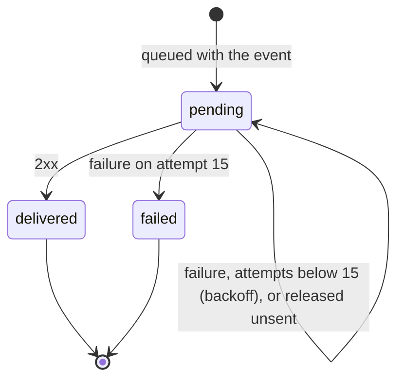
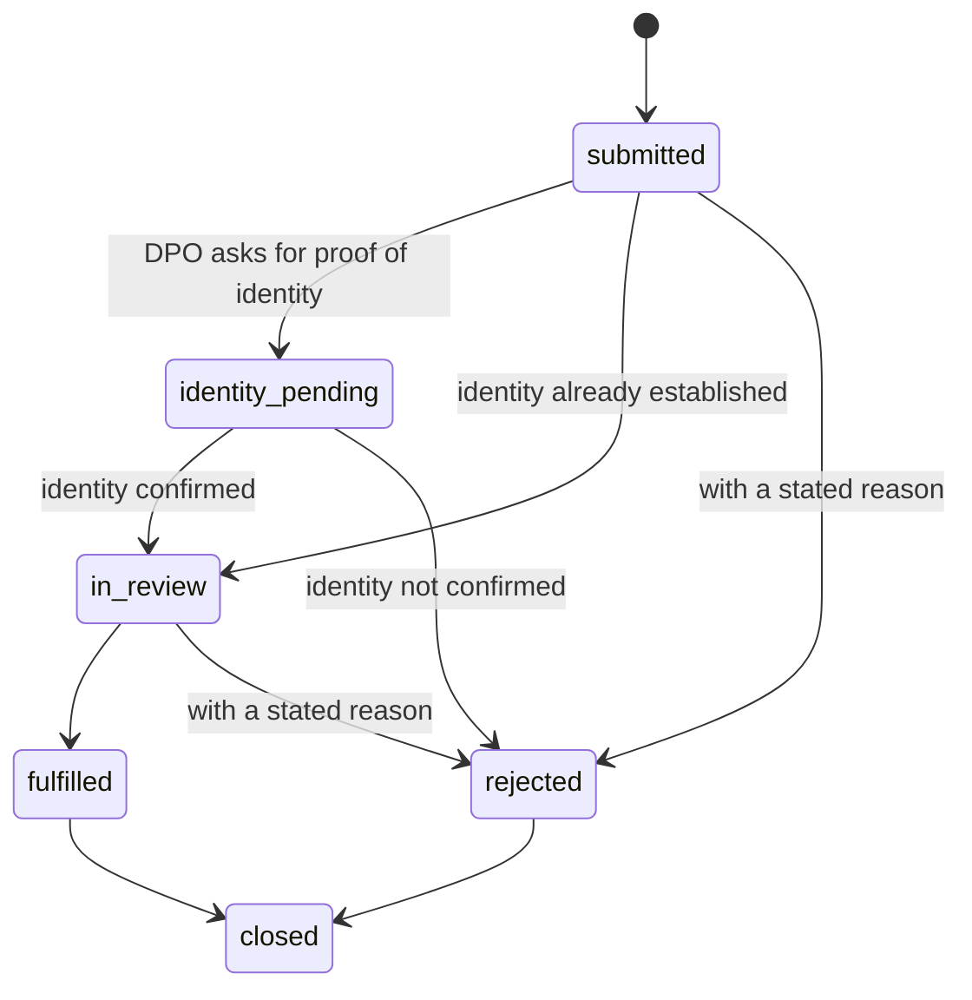

# Low-level design

Status: describes the code as built on 2026-11-06. Sections 9 to 11 are **designed, not built** and say so. The HTTP contract is `docs/design/openapi.yaml` (a test fails when the routes or their access rules drift from it). Architecture and flows are in `docs/design/HLD.md`.

## 1. Repository map

| Path | What it is |
|---|---|
| `packages/schemas` | `canonicalAuditEntry`, `canonicalConsentRecord`, version constants. No dependencies, no crypto. |
| `packages/audit-chain` | `entryHash`, `sealEntry`, `verifyChain`, `merkleRoot`, `merkleProof`, `verifyMerkleProof`, `buildAnchor`, `anchorBody`, `verifyAgainstAnchor`. Node `crypto` only. |
| `packages/receipts` | `buildReceiptClaims`, `validateClaims`, `signReceipt`, `verifyReceipt`, `buildJwks`, `createLocalSigner`. Node `crypto` only (`jose` is a test-only oracle). |
| `packages/notice` | `validateNoticeInput`, `renderNotice`, `canonicalNoticeText`, `noticeSha256`. |
| `packages/sdk-js` | `init`, the dialog and its state. tsup builds IIFE, ESM and CJS. |
| `apps/api` | NestJS 12 (ESM). `src/` code, `db/migrations/` SQL, `test/` end-to-end and database tests. |
| `apps/site` | Next.js 16: home page and the notice generator (client-side only). |
| `apps/web`, `apps/wallet`, `apps/ml` | Shells with a heading or a health route. |
| `infra/terraform` | Audit anchor bucket module and the dev, staging and prod stacks. |

## 2. Canonical strings v1 (frozen, ADR 0002)

A canonical string is `JSON.stringify` of a fixed-order array of validated values, so no field can be mistaken for another.

- Audit entry: `["saral.audit", 1, tenantId, seqNo, ts, actorType, actorId, action, refTable, refId, payloadSha256]`
- Consent record: `["saral.consent", 1, tenantId, consentId, principalId, noticeId, noticeSha256, purposes, status, grantedAt, withdrawnAt, collectionMethod]`, with `purposes` as `[key, granted, retentionDays]` triples sorted by key in code-unit order.
- Rules: lowercase UUIDs; `seqNo` a decimal string up to bigint range; timestamps `YYYY-MM-DDTHH:mm:ss.sssZ` that round-trip; hashes 64 lowercase hex; `action` matches `^[a-z]+(\.[a-z_]+)+$`; `actorId` null or 1 to 128 characters; purposes unique, 1 or more, retention 0 to 36500 days; `withdrawnAt` set exactly when the status is `withdrawn`. Anything else throws `CanonicalError` naming the field.
- Other record kinds that need an audit `payloadSha256` define their own small canonical array next to their service (for example `["saral.webhook_endpoint", 1, tenantId, id, url, sortedEvents, secretVersion]`).

## 3. Audit chain

- `entryHash = HMAC-SHA256(key, prevHash || canonical)`, lowercase hex, key at least 32 bytes. `prevHash` of a tenant's first entry is 64 zeros.
- A verify request is limited to 100,000 entries (`AuditService.maxEntries`) and answers 422 `too_large` beyond it; verify by UTC day instead.
- `verifyChain(entries, resolveKey, { startPrevHash, startSeqNo, startHmacSchemaVersion })` checks each entry in order: same tenant, supported canonical version, contiguous `seqNo` (BigInt), previous hash, key known, key version not lower than before, fields valid, hash equal (constant time). The first failure is returned as `{ ok: false, failure, seqNo }` with `failure` one of `tenant_mismatch`, `unsupported_version`, `seq_gap`, `prev_mismatch`, `unknown_key`, `key_version_regression`, `invalid_fields`, `hash_mismatch`.
- Merkle tree: RFC 6962. Leaf hash `SHA-256(0x00 || 32 bytes of the entry hash)`, node `SHA-256(0x01 || left || right)`, split at the largest power of two below n, empty tree `SHA-256("")`. Inclusion proofs follow RFC 9162. A proof binds a leaf to a root; the size only shapes the path, so the anchor's `count` pins the size.
- Anchor: `{ version: 1, tenantId, date, count, firstSeqNo, lastSeqNo, headHash, merkleRoot }`. `anchorBody` is compact JSON in that key order plus a newline: the exact bytes for S3. `verifyAgainstAnchor` verifies the chain and then every anchor field, which catches truncation and key-holder rewrites.

## 4. Receipts

- Claims are the KI-CR-v1.1.0 receipt in the field names of the specification's JSON schema (`policyUrl`, `piiControllerUrl`, array `purposeCategory`; the prose of the specification disagrees, see `docs/RESEARCH.md` section 6) plus `iat`. `piiPrincipalId` must be a pseudonymous UUID. `consentReceiptID` must be a UUID v4. `policyUrl` must be https without credentials. `thirdPartyName` is required when disclosure is true; `spiCat` must be non-empty when `sensitive` is true.
- Extension claims `saralConsentId`, `saralNoticeId` and `saralNoticeSha256` (validated when present) say which consent and which exact notice text a receipt covers. `signReceipt` refuses a token the verifier would refuse (over 16 KiB).
- `signReceipt` validates, then signs `base64url(header).base64url(payload)` with RS256. Header: `{ alg: "RS256", typ: "JWT", kid }`, where `kid` is the RFC 7638 thumbprint.
- `verifyReceipt` order: token at most 16 KiB and three segments; canonical base64url; `alg` is exactly `RS256` (so `none`, HS256 confusion and others fail as `bad_alg`); the `kid` is in the key set; the key is RSA, `use` is `sig`, `alg` is `RS256` if set, modulus at least 2048 bits, exponent at least 65537; the signature verifies; the claims validate. Error codes: `malformed`, `bad_alg`, `unknown_kid`, `bad_key`, `weak_key`, `bad_signature`, `bad_claims`.
- `buildJwks` copies only `kty`, `n`, `e`, `kid`, `alg`, `use` and throws on private members, duplicate ids or non-RSA keys.

## 5. Notice engine

- Input is validated into one error list with field paths. Strings are trimmed, single line (no control or bidi characters; Indic zero-width joiners allowed), length-capped; URLs are https without credentials; at most 30 purposes with at most 50 data items each.
- `renderNotice(input, "en" | "hi")` fills fixed templates. Values are inserted once as plain strings. Sections: who we are, what data and why, who we share it with, rights, withdrawal, children, complaint, about this draft. Every notice has `reviewStatus: "pending-human-review"` and a banner.
- `canonicalNoticeText`: Unicode NFC, LF line endings, no trailing spaces, one final newline. `noticeSha256` is the SHA-256 of that text through Web Crypto. The database stores the canonical text and checks that its hash matches.

## 6. API

### 6.1 Settings

| Variable | Use |
|---|---|
| `PORT` | HTTP port, default 4000. |
| `DATABASE_URL` | PostgreSQL connection. Missing: database routes answer 503. |
| `NODE_ENV` | `production` makes the key provider answer 503 instead of using development keys. |
| `SARAL_DEV_MASTER_SECRET` | At least 32 characters. Development and test only; derives every key. Without it a random one is made per process. |
| `SARAL_WEBHOOK_WORKER` | `on` starts the delivery poller in this process. |
| `PUBLIC_BASE_URL` | Public https base URL of the API, used in receipts. |

### 6.2 Request path

1. CORS (`configureApp`): reflects the origin, allows `Authorization`, `Content-Type` and `Idempotency-Key`, never credentials.
2. `AuthGuard` (global): no `@Public()` or `@Scopes()` on the route gives 403. Otherwise parse `Authorization: Bearer <key>`, read the key row under the `key_lookup` policy, compare the HMAC of the secret in constant time, reject revoked keys and a kind mismatch (all with the same 401 body), check the origin list of a publishable key, check scopes (403). The result is `req.auth = { keyId, tenantId, kind, scopes }`.
3. Controller validates the body with small helpers (`objectBody`, `uuidParam`, `normalizeIdentifier`, ...) and answers 400 with `{ error: "invalid_request", field, message }`.
4. `Database.inScope({ tenantId })` (pool of 10, 5 second wait for a connection, 30 second statement limit, errors on idle connections are logged): `BEGIN`, `SET LOCAL ROLE saral_app`, `set_config('app.tenant_id', ..., true)`, the work, `COMMIT` or `ROLLBACK`. `Database.asWorker` does the same as `saral_worker` for the webhook worker.

### 6.3 API keys

`pk_<32 hex>_<43 base64url>` or `sk_...`. The 32 hex are the key's UUID without dashes. Only `HMAC-SHA256(pepper, secret)` is stored. A publishable key has exactly the scope `sdk` (a CHECK). Keys are issued by operators through `issueApiKey` (the API role cannot write keys); there is no route for it yet.

### 6.4 Consent grant (`ConsentService.grant`, one transaction)

Read tenant profile and notice; map the request's purposes (sorted by key) to the notice's definitions (unknown purpose is 422; retention comes from the definition); at least one purpose must be granted (422); principal id from the pseudonym `HMAC(pseudonymKey, JSON(["saral.principal", identifier, tenantId]))`; take the tenant lock, and if the request carries an `Idempotency-Key` that was already used for the same request (same person, notice and choices, consent still granted) return the first result (200; a different request or a no-longer-granted consent is 409); otherwise insert the consent (with the key); append the audit entry with `payloadSha256 = SHA-256(canonicalConsentRecord)`; build and sign the receipt (an incomplete profile is 422 and rolls everything back); insert the receipt; enqueue webhooks. The receipt's `policyUrl` is `<PUBLIC_BASE_URL>/v1/notices/<id>` when that https base is configured (the notice never changes), otherwise the tenant's own page. Withdrawal is the same shape with a state change and a `consent.withdrawn` entry; `POST /v1/consents/withdraw` (secret keys only) does it for every granted consent of a person found by identifier. Migration 0005 adds `consent_records.idempotency_key`, unique per tenant.

### 6.5 Audit append (`AuditService.append`)

`audit_append_lock(tenant)`, read the head, `ts = max(now, head.ts)`, `seqNo = head + 1`, seal with the current key version, insert. The database also checks the link and the shape.

### 6.6 Webhooks

Registration (`tenant_admin`): URL rules and SSRF checks (`url-guard.ts`), at most 10 active endpoints per tenant counted under the tenant lock, an audit entry, and the secret `whsec_<base64url>` shown once. `DELETE /v1/webhook-endpoints/{id}` disables an endpoint (frees its slot; the worker closes events still waiting for it) and `POST .../rotate-secret` bumps `secret_version` and shows the new secret once; both are audit events. The secret is `HMAC(webhookKey, "<endpointId>:<secretVersion>")`; nothing is stored. Delivery: see HLD 4.4; every run first sweeps rows that can never be sent (15 attempts left by a crashed worker, disabled endpoints). Header `X-Saral-Signature: t=<unix>,v1=<HMAC-SHA256 of "<t>.<body>">`. Body `{ id, type, createdAt, data }` with ids and states only.

## 7. Database (migrations 0001 to 0006)

| Table | Notes |
|---|---|
| `tenants` | `profile` jsonb (controller details, policy URL, service name) set by operators; read-only for the API role. |
| `tenant_principals` | `(tenant_id, id)` key; `pseudonym_hmac` unique per tenant. No raw identifiers. |
| `privacy_notices` | One row per language per version; canonical text and its SHA-256 (CHECKed); `purpose_definitions` jsonb; insert-only for the API role; also readable by id through `app.public_notice_id`. |
| `consent_records` | Composite foreign keys to the principal and to `(tenant_id, notice_id, notice_sha256)`. A trigger allows only `granted` to `withdrawn` or `expired` and changes to `status` and `withdrawn_at` only. |
| `consent_receipts` | Insert-only. |
| `consent_audit_log` | Primary key `(tenant_id, seq_no)`; triggers check the chain link, refuse update, delete and truncate; millisecond timestamps. |
| `api_keys` | Visible only through `app.api_key_id`. |
| `webhook_endpoints`, `webhook_deliveries` | Outbox; the `saral_worker` role reads due rows of every tenant and updates outcome columns only. |

Every tenant-owned table has row-level security enabled and forced with a policy that also checks writes. Every function pins `search_path = pg_catalog, public, pg_temp`; `TEMPORARY` is revoked from `PUBLIC`. Migrations are SQL files applied by a small runner that records SHA-256 checksums and refuses edits to applied files. `pnpm --filter @saral/api db:migrate` applies them.

## 8. State machines

Consent (enforced by a trigger): `granted` to `withdrawn` or `expired`. A finished consent never changes; a new consent is a new row.

Webhook delivery:

SDK: `closed`, `banner`, `manage`. First visit opens `banner`. A decision (`granted` or `refused`) is stored; with `granted`, the opener shows `manage`, where withdrawal clears the state.

## 9. Data-principal rights (built)

States: `submitted`, `identity_pending`, `in_review`, `fulfilled`, `rejected`, `closed`. Types: `access`, `correction`, `erasure`, `nomination`, `grievance`. The state machine is in `apps/api/src/dsr/state.ts` and is enforced again by a database trigger; a test compares all 36 state pairs between the two.

- Tables (migration 0006): `dsr_requests` (row-level security; the API role may update only `state`, `decided_reason` and `closed_at`), `principal_contacts` (the person's contact sealed with AES-256-GCM, `src/crypto/contact-crypto.ts`: version byte, 12-byte nonce, ciphertext, tag; bound to tenant and person as associated data). Webhook events `dsr.submitted` and `dsr.transitioned` (ids and states only).
- `slaDueAt(submittedAt, type)` is 30 days for every type, a working default **not confirmed against the Rules**.
- Routes: `POST /v1/dsr` (`sdk`; same answer for known and unknown people), `GET /v1/dsr` with `state` and `overdue` filters, `GET /v1/dsr/{id}`, `POST /v1/dsr/{id}/transition` (409 with the allowed moves; a rejection needs a reason), `POST /v1/dsr/{id}/reveal-contact` (410 after erasure). All but the first need the `dpo` scope, which is a secret API key until staff login exists.
- Every submission, move and contact read is an audit entry (`dsr.submitted`, `dsr.transitioned`, `dsr.contact_revealed`) with a hash of the request's state and reason.
- Fulfilling an **erasure** request runs, in the same transaction as the move: withdraw all of the person's granted consents (each audited and queued), delete the sealed contact, replace `tenant_principals.pseudonym_hmac` with a random value so the identifier no longer leads to the person. The audit chain keeps its entries and still verifies. The lawyer advisor must confirm that this satisfies the Act (`docs/PLAN.md` section 5.2).
- Threat model: `docs/threat-model/0007-rights-requests.md`.

## 10. Staff login with MFA (designed, not built)

Staff users per tenant with role `tenant_admin` or `dpo`. Password hashed with scrypt (N 32768, r 8, p 1, 16-byte salt, pinned in an ADR). TOTP per RFC 6238 (30 s step, 6 digits, one step of drift allowed, replay inside the window refused), secrets encrypted with an application key; recovery codes stored hashed and single-use. Five failed logins lock the account for 15 minutes. A session token is RS256 signed with a session key separate from the receipt key, valid 15 minutes, issued only after MFA; a session without completed MFA gets 403 on every scoped route. The API accepts a session token or an API key for the same scopes. Routes: `POST /v1/auth/login`, `/v1/auth/mfa/enroll`, `/v1/auth/mfa/verify`.

## 11. Dashboard (designed, not built)

`apps/web`, reusing the design tokens and system-font approach of `apps/site` (light theme, WCAG AA contrast, no third-party requests). Screens: sign-in with MFA; overview (consent funnel and audit health from `/v1/audit/verify`); notices (list, publish); consent search; DSR queue with SLA badges and the transition actions; verifier panel. Each screen has loading, empty, error and success states and works by keyboard alone. The API client is typed from `docs/design/openapi.yaml`.

## 12. Tests

`pnpm verify` runs lint, type checks, every test and every build. The API tests need PostgreSQL 16 (`pnpm db:up` and `DATABASE_URL`); they create throwaway databases, run as `saral_app`, and fail rather than skip without a database. Counts on this branch: schemas 47, audit-chain 67, receipts 76, notice 43, site 15, sdk-js 59, API 371. Mutation checks (a manual edit of the code that must make a test fail) are recorded in each pull request.
